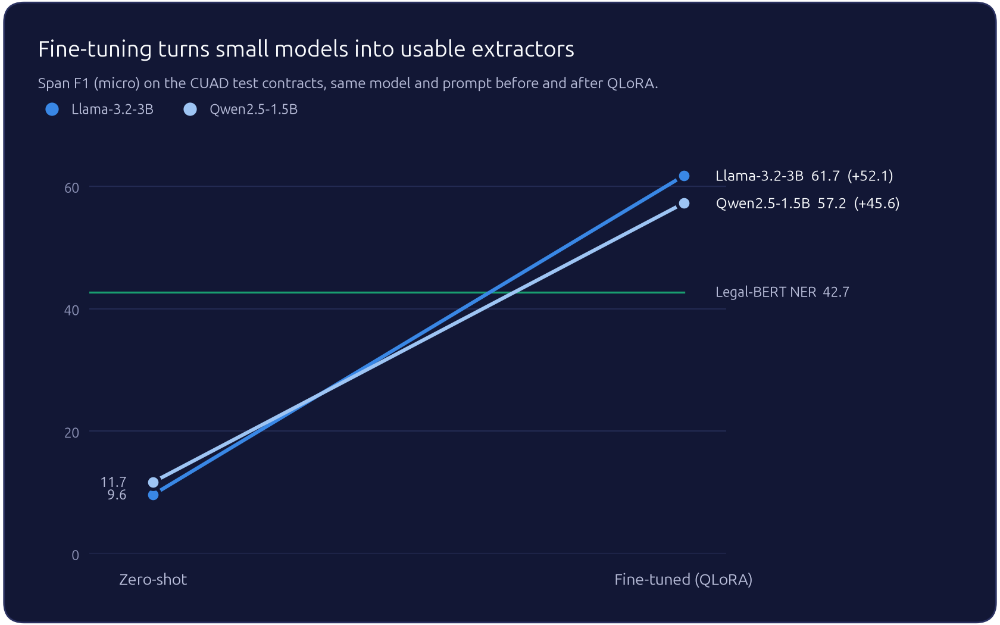
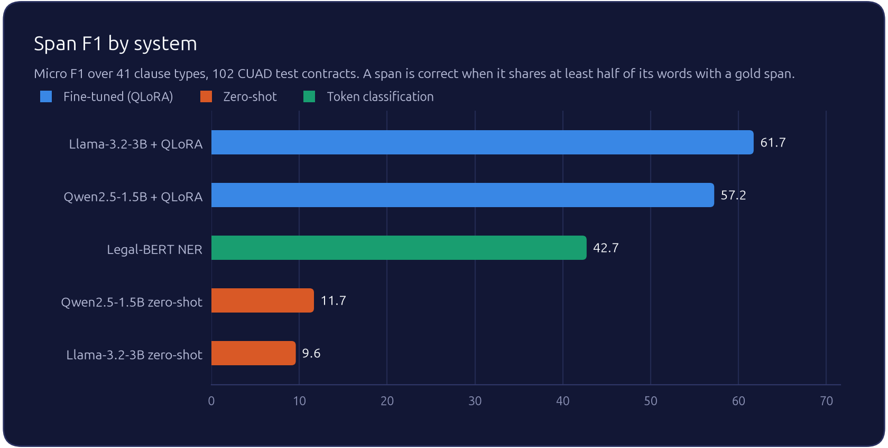
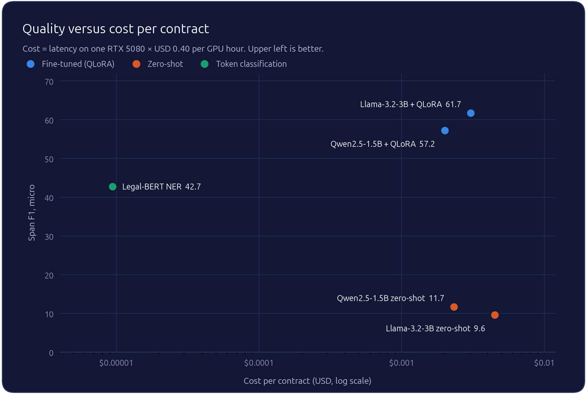
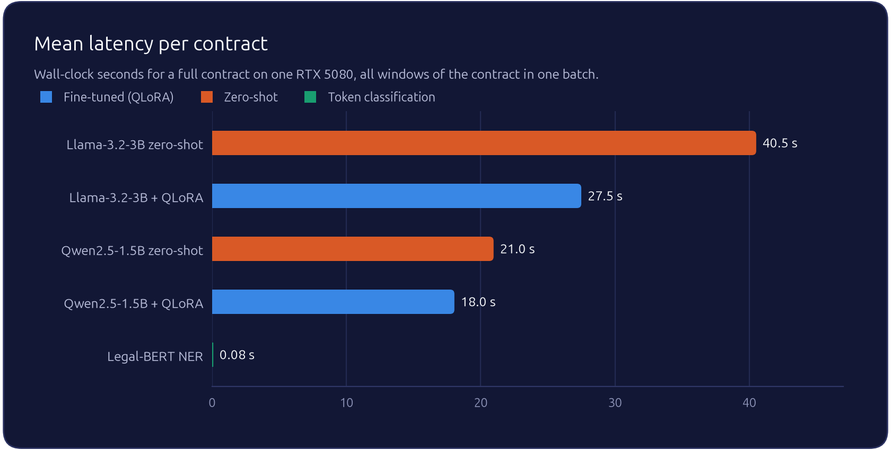
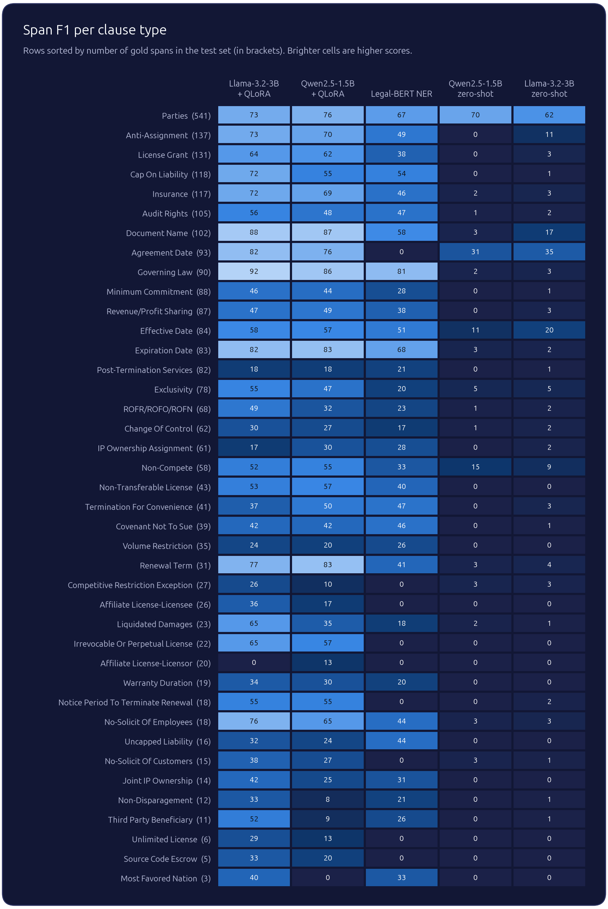
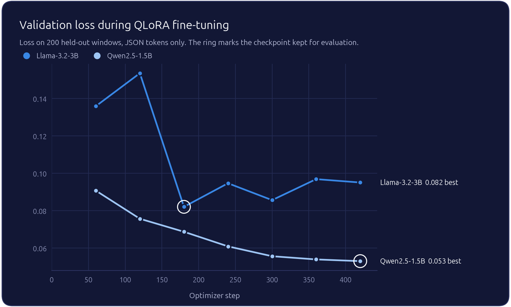

<div align="center">



<br/>


<p>
  
  
  
  
</p>
<p>
  
  
  
  
  
</p>
<p>
  <a href="https://huggingface.co/Z-Nadjib/Llama-3.2-3B-ClauseLM"></a>
  <a href="https://huggingface.co/Z-Nadjib/ClauseLM-Qwen2.5-1.5B"></a>
</p>

<p>
  <a href="#results"><b>Results</b></a> &nbsp;|&nbsp;
  <a href="#installation"><b>Installation</b></a> &nbsp;|&nbsp;
  <a href="#usage"><b>Usage</b></a> &nbsp;|&nbsp;
  <a href="#configuration"><b>Configuration</b></a> &nbsp;|&nbsp;
  <a href="#method"><b>Method</b></a> &nbsp;|&nbsp;
  <a href="#models"><b>Models</b></a> &nbsp;|&nbsp;
  <a href="#citation"><b>Citation</b></a>
</p>

</div>

<br/>

**Contract Clause Extraction** fine-tunes small open-weight language models to turn commercial
contracts into structured JSON. For each of the 41 clause categories of
[CUAD](https://www.atticusprojectai.org/cuad) (parties, dates, renewal terms, governing law,
termination rights, restrictive covenants, licences, liability caps, insurance and more), the
model returns the passages of the contract that belong to it, copied verbatim so that every
prediction can be traced back to the source text. Everything runs locally on a single 16 GB GPU.
The repository contains the data pipeline, the QLoRA training code, the grammar-constrained
inference, the evaluation against zero-shot and BERT baselines, the result tables and figures,
and a local Gradio demo. Both fine-tuned models are published on the
[Hugging Face Hub](https://huggingface.co/Z-Nadjib).

<p align="center">
  
</p>

## How it works

Contracts are far longer than the context of a small model, so each contract is cut into
overlapping windows. The fine-tuned model reads one window at a time and writes a JSON object,
while a grammar compiled from the output schema masks every token that would break it. Window
results are then merged back into one JSON object per contract.

<p align="center">
  
</p>

Example output for one window:

```json
{"document_name": ["SUPPLY CONTRACT"], "insurance": ["To be covered by the Seller for 110% invoice value against All Risks and War Risk."]}
```

<p align="center"></p>

## Results

<p align="center">
  
</p>

102 contracts of the official CUAD test split, one RTX 5080 (16 GB). Full tables in
[`reports/results/`](reports/results/).

| System | Params | Span P | Span R | Span F1 (micro) | Span F1 (macro) | Presence F1 | Grounded spans | Latency / contract (mean, p50) | Cost / contract |
|---|---|---|---|---|---|---|---|---|---|
| **Llama-3.2-3B + QLoRA** | 3.2B | **66.0** | 57.9 | **61.7** | **50.4** | **83.8** | 97.4% | 27.5 s, 12.4 s | USD 0.0031 |
| Qwen2.5-1.5B + QLoRA | 1.5B | 55.8 | **58.8** | 57.2 | 43.2 | 80.9 | 98.6% | 18.0 s, 9.0 s | USD 0.0020 |
| Legal-BERT NER | 0.11B | 36.0 | 52.4 | 42.7 | 30.2 | 80.8 | 100% | **0.08 s, 0.04 s** | **USD 0.00001** |
| Qwen2.5-1.5B zero-shot | 1.5B | 8.1 | 21.0 | 11.7 | 3.9 | 49.9 | 43.5% | 21.0 s, 7.5 s | USD 0.0023 |
| Llama-3.2-3B zero-shot | 3.2B | 5.7 | 30.4 | 9.6 | 5.0 | 49.5 | 20.9% | 40.5 s, 22.1 s | USD 0.0045 |

All generative systems use grammar-constrained decoding and produce 100% usable JSON. Cost is
latency multiplied by an on-demand rental price of USD 0.40 per GPU hour.

<p align="center">
  
</p>

**Fine-tuning is what makes small models usable.** Without fine-tuning, both models detect
whether a clause type is present only half of the time (presence F1 near 50%) and most of their
spans are paraphrased or invented: only 21% to 44% of them can be found in the contract. QLoRA
on 3,402 examples raises span F1 by 45 points for Qwen2.5-1.5B and 52 points for Llama-3.2-3B,
and more than 97% of the extracted spans become verbatim copies of the contract.

<p align="center">
  
</p>

**Generative extraction outperforms token classification on spans.** Legal-BERT detects clause
types as well as Qwen2.5-1.5B (presence F1 80.8 vs 80.9) but reaches 42.7 span F1 against 57.2
and 61.7. Part of the gap is structural: BIO tagging cannot represent the 23% of gold spans that
overlap another category. Legal-BERT remains more than 200 times faster, which makes it a
reasonable first-pass filter.

**The 3B model is better on rare clauses.** Llama-3.2-3B gains 4.5 points of micro F1 over
Qwen2.5-1.5B but 7.2 points of macro F1, with the largest differences on infrequent categories
such as *Third Party Beneficiary*, *Liquidated Damages* and *Non-Disparagement*. It costs about
1.5 times more per contract.

<p align="center">
  
</p>

On owned hardware, the electricity cost at the 360 W board limit is USD 0.00045 per contract for
Qwen2.5-1.5B and USD 0.00069 for Llama-3.2-3B. Latency is dominated by long contracts: the p95
is 87 s for Qwen2.5-1.5B and 120 s for Llama-3.2-3B, and the slowest contracts are those above
100k characters.

<p align="center">
  
</p>

### Per-field scores

<p align="center">
  
</p>

Fields with a short, regular form are extracted reliably by the fine-tuned models: governing
law (92 F1), document name (88), expiration date (82), agreement date (82). Long or diffuse
clauses remain difficult for every system: post-termination services (18), IP ownership
assignment (17 to 30), change of control (27 to 30).

### Constrained decoding

| Model | Decoding | Contracts | Valid JSON as generated | Usable JSON | Span F1 (micro) |
|---|---|---|---|---|---|
| Qwen2.5-1.5B + QLoRA | constrained | 30 | 98.8% | **100%** | 55.3 |
| Qwen2.5-1.5B + QLoRA | unconstrained | 30 | 98.8% | 98.8% | 56.1 |

After fine-tuning, the model has learned the output format: without the grammar, 98.8% of its
outputs are already valid. The remaining 1.2% are generations stopped by the loop guard or the
token budget. Under the grammar, such outputs are always a prefix of a valid object and are
closed after their last complete span, which brings usable outputs to 100% and removes any
parsing failure in production. The difference in span F1 is within the variation expected on 30
contracts.

### Training

<p align="center">
  
</p>

The checkpoint with the lowest validation loss is kept: the last step for Qwen2.5-1.5B, step 180
(0.85 epoch) for Llama-3.2-3B, whose validation loss is noisier after the first epoch. Losses of
the two models are computed with different tokenizers and are not directly comparable.

<p align="center"></p>

## Installation

Requirements: Python 3.10 or later and one CUDA GPU with 16 GB of memory. The versions used for
the reported results are pinned in [`requirements.txt`](requirements.txt).

```bash
git clone https://github.com/Z-Nadjib/ClauseLM-ContractExtraction-CUAD.git
cd ClauseLM-ContractExtraction-CUAD
make setup
```

`make setup` creates `.venv/`, installs the pinned dependencies and the `contract_extractor`
package in editable mode.

## Data

[CUAD v1](https://www.atticusprojectai.org/cuad) (Hendrycks et al., 2021) contains 510
commercial contracts from SEC filings, annotated by lawyers with more than 13,000 spans across
41 clause categories, under the CC BY 4.0 license. `make data` downloads the official release
and builds the training files.

| Split | Contracts | Use |
|---|---|---|
| train | 367 | fine-tuning |
| validation | 41 | checkpoint selection, held out from the official train split |
| test | 102 | every reported result, official CUAD test split |

Contracts are long: 54k characters on average (about 13k tokens), up to 338k characters. Around
23% of the gold spans overlap a span of another category, for example a sentence that is both a
*License Grant* and a *Non-Transferable License*.

<p align="center"></p>

## Usage

Every step has a `make` target; each one calls a script of [`scripts/`](scripts/) with a YAML
file of [`configs/`](configs/).

```bash
make data           # download CUAD and build the SFT datasets
make train-qwen     # QLoRA on Qwen2.5-1.5B-Instruct, about 30 minutes on an RTX 5080
make train-llama    # QLoRA on Llama-3.2-3B-Instruct, about 50 minutes
make train-bert     # Legal-BERT token classification baseline, about 3 minutes
make merge          # merge the LoRA adapters into 16-bit weights
make eval-all       # all systems on the 102 test contracts, about 5 hours
make report         # tables in reports/results, figures in reports/figures
make test           # unit tests
make demo           # Gradio demo on http://127.0.0.1:7860
```

### Evaluate one system

```bash
.venv/bin/python scripts/evaluate.py --systems qwen2.5-1.5b-cuad --max-documents 10
```

| Option | Description |
|---|---|
| `--systems` | one or more system names defined in `configs/eval.yaml` |
| `--max-documents` | evaluate only the first N test contracts |
| `--config` | evaluation config, `configs/eval.yaml` by default |
| `--data-config` | chunking config, `configs/data.yaml` by default |

Predictions are written contract by contract, so an interrupted evaluation resumes where it
stopped. Training resumes from the last checkpoint with
`scripts/train_sft.py --config <config> --resume`.

### Extract from Python

```python
from contract_extractor.inference.base import ChunkedExtractor
from contract_extractor.inference.hf_backend import HFBackend

backend = HFBackend("outputs/qwen2.5-1.5b-cuad/merged", constrained=True)
extractor = ChunkedExtractor(backend, chunk_size=6000, chunk_overlap=600, batch_size=8)
result = extractor.extract(open("contract.txt").read())
print(result.extraction["governing_law"])
```

## Configuration

| File | Content |
|---|---|
| [`configs/data.yaml`](configs/data.yaml) | window size and overlap, clipping of boundary spans, validation share, subsampling of empty windows |
| [`configs/train/qwen2.5-1.5b.yaml`](configs/train/qwen2.5-1.5b.yaml) | QLoRA run on Qwen2.5-1.5B-Instruct |
| [`configs/train/llama3.2-3b.yaml`](configs/train/llama3.2-3b.yaml) | QLoRA run on Llama-3.2-3B-Instruct |
| [`configs/train/bert-ner.yaml`](configs/train/bert-ner.yaml) | Legal-BERT token classification run |
| [`configs/eval.yaml`](configs/eval.yaml) | evaluated systems, match threshold, GPU price and power used for the cost |

## Outputs

| Path | Content |
|---|---|
| `data/processed/` | `sft_train.jsonl`, `sft_validation.jsonl`, `splits.json`, `stats.json` |
| `outputs/<run>/` | LoRA adapter, checkpoints, `train_summary.json`, merged 16-bit model |
| `reports/results/predictions/` | one JSON line per contract and system, with raw window outputs |
| [`reports/results/metrics/`](reports/results/metrics/) | per-field, micro and macro scores, JSON validity, latency and cost per system |
| [`reports/results/`](reports/results/) | `summary.md`, `summary.csv`, `per_field_f1.csv`, constrained decoding ablation |
| [`reports/figures/`](reports/figures/) | the figures of this README |

<p align="center"></p>

## Method

### Text to JSON pairs

1. Each contract is split into windows of 6,000 characters (about 1.5k tokens) with 600
   characters of overlap. Cuts are placed on paragraph, line, sentence or word boundaries. The
   windows are character based, so every system sees exactly the same inputs.
2. The target of a window is a JSON object holding, for each field present in the window, the
   list of gold spans it contains. Fields with no span are omitted, which keeps targets short
   (`{}` for a window without any clause). Spans crossing a window boundary are clipped and kept
   when at least half of the span, or at least 300 characters, are visible.
3. Windows without any clause are subsampled to 50% of their count in the training set (21% of
   the final training examples are empty).

This produces 3,406 training examples and 514 validation examples. The prompt lists the 41 field
names with a one-line definition each and is shared by all generative systems
([`prompts.py`](src/contract_extractor/prompts.py)).

### Fine-tuning

QLoRA with [Unsloth](https://github.com/unslothai/unsloth) and
[TRL](https://github.com/huggingface/trl) `SFTTrainer`.

| | Qwen2.5-1.5B-Instruct | Llama-3.2-3B-Instruct |
|---|---|---|
| Base weights | 4-bit NF4 | 4-bit NF4 |
| LoRA | r=32, alpha=32, all linear projections | r=32, alpha=32, all linear projections |
| Max sequence length | 4,096 | 4,096 |
| Effective batch size | 16 | 16 |
| Learning rate | 2e-4, cosine, 3% warmup | 2e-4, cosine, 3% warmup |
| Epochs | 2 | 2 |
| Loss | completion tokens only | completion tokens only |
| Checkpoint selection | lowest validation loss | lowest validation loss |

### Constrained decoding

Generation is constrained by a grammar compiled from the extraction JSON Schema with
[xgrammar](https://github.com/mlc-ai/xgrammar)
([`guards.py`](src/contract_extractor/inference/guards.py),
[`hf_backend.py`](src/contract_extractor/inference/hf_backend.py)). At every step, tokens that
would produce an unknown key, a non-list value or malformed JSON are masked out, so every
completed generation is valid JSON that matches the schema. The masking adds less than 5% to the
decoding time per step. Two guards handle generations that do not complete:

* **Loop detection.** Greedy decoding occasionally enters a cycle, such as the same escaped
  newline repeated. When the last tokens of a sequence form a cycle of period up to 64 tokens
  over at least 48 tokens, that sequence alone is ended. Without this guard, one looping window
  holds the whole batch until the 2,048 token budget is spent.
* **Closing truncated outputs.** Under the grammar, any partial output is a prefix of a valid
  object, so a cut output is closed after its last complete span instead of being discarded.

Decoding is greedy with `repetition_penalty=1.0`: the default generation config of
Qwen2.5-Instruct sets a penalty of 1.1, which penalizes copying tokens of the contract.

### Document-level merging

Window predictions are mapped back to character offsets in the contract. Overlapping spans of the
same field, typically the same clause seen in two consecutive windows, are replaced by their
union. Spans that cannot be found in the source window are kept once, verbatim, and counted as
ungrounded.

### Baselines

* **Zero-shot**: the same base models and prompt without fine-tuning, with constrained decoding.
* **Legal-BERT NER**:
  [`nlpaueb/legal-bert-base-uncased`](https://huggingface.co/nlpaueb/legal-bert-base-uncased)
  fine-tuned for token classification with BIO tags (83 labels), 512-token windows with a
  128-token stride, probabilities averaged over overlapping windows. BIO tagging assigns a single
  label per token, so overlapping spans cannot all be represented: decoding the gold labels
  themselves gives a span F1 of 88.6%, the ceiling of this formulation.

### Evaluation protocol

All numbers are computed at document level on the 102 official test contracts
([`metrics.py`](src/contract_extractor/evaluation/metrics.py)), except the constrained decoding
ablation, which uses the first 30 of them.

| Metric | Definition |
|---|---|
| Span P, R, F1 | a predicted span is correct when its word-level Jaccard similarity with an unmatched gold span of the same field is at least 0.5, the criterion of the CUAD paper; micro pools all fields, macro averages the fields present in the test set |
| Presence F1 | whether the system detects that a clause type exists in the contract, regardless of span boundaries |
| Valid JSON | share of window outputs that parse and conform to the schema as generated; *usable* also counts constrained outputs closed after truncation |
| Grounded spans | share of predicted spans found in the source text |
| Latency | wall-clock time for one contract, all its windows in one batch, transformers with bf16 weights on one RTX 5080 |
| Cost | latency times USD 0.40 per GPU hour; energy cost at 360 W and USD 0.25 per kWh |

<p align="center"></p>

## Models

Both fine-tuned models are public on the Hugging Face Hub, with the LoRA weights merged into
16-bit checkpoints and a model card describing training, results and usage.

| Model | Params | Span F1 | License | |
|---|---|---|---|---|
| [**Z-Nadjib/Llama-3.2-3B-ClauseLM**](https://huggingface.co/Z-Nadjib/Llama-3.2-3B-ClauseLM) | 3.2B | 61.7 | Llama 3.2 Community License | best quality |
| [**Z-Nadjib/ClauseLM-Qwen2.5-1.5B**](https://huggingface.co/Z-Nadjib/ClauseLM-Qwen2.5-1.5B) | 1.5B | 57.2 | Apache 2.0 | faster, smaller |

Extract the clauses of a full contract with a published model, with the same windows,
grammar-constrained decoding and merging as in the evaluation:

```python
from contract_extractor.inference.base import ChunkedExtractor
from contract_extractor.inference.hf_backend import HFBackend

backend = HFBackend("Z-Nadjib/Llama-3.2-3B-ClauseLM", constrained=True)
extractor = ChunkedExtractor(backend, chunk_size=6000, chunk_overlap=600, batch_size=8)
result = extractor.extract(open("contract.txt").read())
print(result.extraction["governing_law"])
```

`make demo` starts a local Gradio app on http://127.0.0.1:7860: paste or upload a contract and
get the merged JSON with a table of the extracted spans. It loads
`Z-Nadjib/ClauseLM-Qwen2.5-1.5B` by default; set `MODEL_ID` to use another model or a local
directory. Four CUAD test contracts are bundled as examples.

## Project structure

```
.
├── app/                     local Gradio demo
├── configs/                 data, training and evaluation configurations
├── docs/assets/             banner, badges and diagrams of this README
├── reports/
│   ├── figures/             result figures
│   └── results/             metrics per system, summary tables, training summaries
├── scripts/                 command line entry points
├── src/contract_extractor/
│   ├── schema.py            41 fields, JSON Schema, output validation
│   ├── prompts.py           prompt shared by all generative systems
│   ├── config.py            typed YAML configurations
│   ├── data/                CUAD loading, windowing, SFT and BIO datasets
│   ├── training/            QLoRA SFT (Unsloth + TRL), Legal-BERT NER
│   ├── inference/           constrained backend, decoding guards, BERT extractor, merging
│   └── evaluation/          metrics, evaluation runner, tables and figures
├── tests/                   unit tests
├── Makefile
└── pyproject.toml
```

## Limitations

* CUAD contains English contracts from US SEC filings. Other jurisdictions, languages and
  contract types are out of distribution.
* Spans are extracted verbatim and not normalized: a date is returned as written in the
  contract, not as an ISO date.
* The rental cost model assumes a dedicated GPU used one contract at a time. A serving engine with
  continuous batching would raise throughput and lower the cost per contract.
* Annotation guidelines leave room for interpretation on the boundaries of long clauses, which
  caps the achievable span F1.

## Citation

```bibtex
@article{hendrycks2021cuad,
  title   = {CUAD: An Expert-Annotated NLP Dataset for Legal Contract Review},
  author  = {Hendrycks, Dan and Burns, Collin and Chen, Anya and Ball, Spencer},
  journal = {NeurIPS Datasets and Benchmarks},
  year    = {2021}
}
```

## Acknowledgements

CUAD is released by [The Atticus Project](https://www.atticusprojectai.org/). The base models
are [Qwen2.5-1.5B-Instruct](https://huggingface.co/Qwen/Qwen2.5-1.5B-Instruct) and
[Llama-3.2-3B-Instruct](https://huggingface.co/meta-llama/Llama-3.2-3B-Instruct); the baseline is
[Legal-BERT](https://huggingface.co/nlpaueb/legal-bert-base-uncased).

## License

Code under the Apache 2.0 license. CUAD data under CC BY 4.0. Fine-tuned Llama weights are subject
to the Llama 3.2 Community License; fine-tuned Qwen weights to the Apache 2.0 license of
Qwen2.5-1.5B-Instruct.

<br/>


